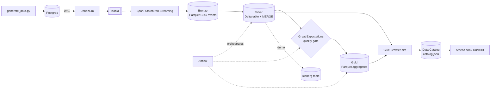
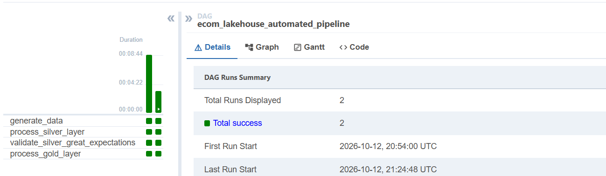
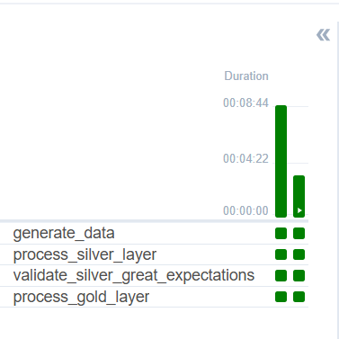
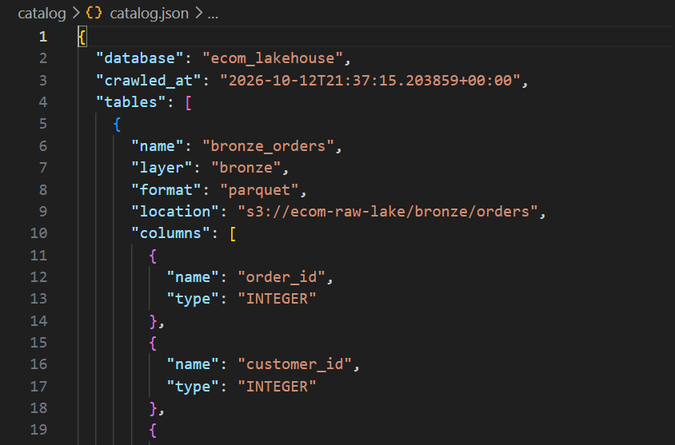
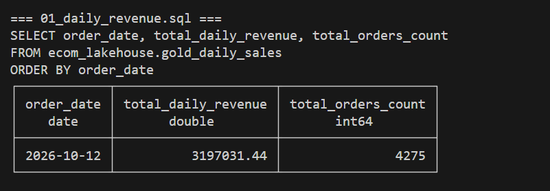
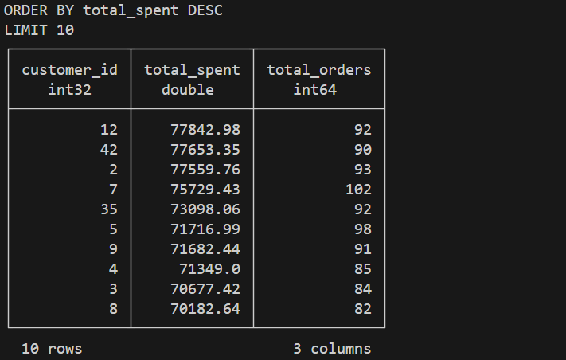
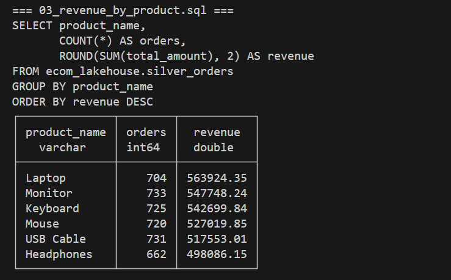
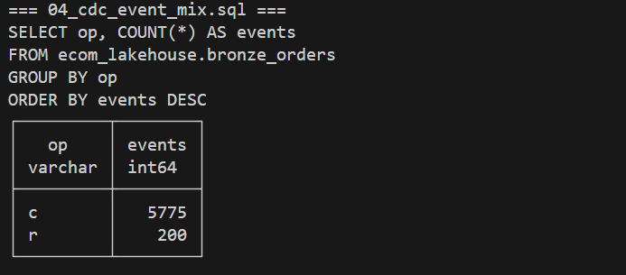

# E-commerce CDC Lakehouse Platform

[](https://github.com/<your-username>/ecom-lakehouse-platform/actions)

A fully containerized, end-to-end data platform: **change data capture** from Postgres into a
**Bronze / Silver / Gold lakehouse** on S3 (LocalStack), with **Delta Lake** upserts, a
**Great Expectations** quality gate, **Apache Iceberg** and **Glue / Athena** simulations,
orchestrated by **Airflow**.

> Everything runs locally with one `docker compose up`. Components that need a paid AWS account
> (Glue Crawler, Athena) are **simulated locally**, and real-AWS scripts are provided in [`aws/`](aws/).

## Architecture



## Tech stack

| Layer | Tools |
|---|---|
| Source & CDC | Postgres 15 (logical replication), Debezium 2.3, Kafka + ZooKeeper |
| Processing | Spark 3.5 Structured Streaming, PySpark batch jobs |
| Table formats | **Delta Lake 3.1** (Silver), **Apache Iceberg 1.5** (demo), Parquet (Bronze/Gold) |
| Orchestration | Apache Airflow 2.8 |
| Data quality | **Great Expectations 1.x** (+ delta-rs for Spark-free reads) |
| Storage | LocalStack S3 (AWS S3 in production) |
| Catalog & query | **Glue Crawler / Athena (simulated)** with DuckDB; real scripts in `aws/` |
| Dev tooling | Docker Compose, `.env` secrets, GitHub Actions + ruff |

## Repository layout

```
.
├── infrastructure/   docker-compose.yml, Dockerfiles, Debezium connector, .env.example
├── ingestion/        generate_data.py (synthetic orders), Init.SQL (schema + seed data)
├── processing/       Spark: streaming ingestion, Silver, Gold, Iceberg demo, shared spark_utils
├── quality/          Great Expectations validation of the Silver table
├── orchestration/    Airflow DAG
├── catalog/          simulated Glue Crawler + simulated Athena (DuckDB)
├── analytics/        saved SQL queries + DuckDB query script
├── aws/              real AWS Glue Crawler / Athena scripts
└── .github/          CI workflow
```

## Quick start

Requirements: Docker Desktop (8 GB RAM recommended).

```bash
cd infrastructure
cp .env.example .env            # Windows: copy .env.example .env  -> then edit the passwords
docker compose up -d --build    # first build takes a while (Java, Spark, Airflow images)
docker compose ps               # one-shot services (s3-setup, debezium-setup, airflow-init) exit 0
```

1. Open Airflow at http://localhost:8080 (user/password from your `.env`) and trigger `ecom_lakehouse_automated_pipeline`.
2. Check the CDC connector: `curl localhost:8083/connectors/ecom-postgres-connector/status`
3. Inspect the lake (from your machine, `pip install duckdb boto3`):
   ```bash
   python analytics/query_lakehouse.py
   python catalog/crawler_sim.py      # discovers tables, writes catalog/catalog.json
   python catalog/athena_sim.py       # runs analytics/queries/*.sql against the catalog
   ```

## Demos

**CDC updates and deletes (Delta MERGE)**
```bash
docker compose exec postgres psql -U postgres -d ecom_db -c "UPDATE orders SET status='refunded' WHERE order_id=1;"
docker compose exec postgres psql -U postgres -d ecom_db -c "DELETE FROM orders WHERE order_id=2;"
```
Re-run the DAG: order 1 is `refunded` in Silver, order 2 is gone, Bronze keeps the full event history.

**Data quality gate** - break the data on purpose and watch Gold get blocked:
```bash
docker compose exec postgres psql -U postgres -d ecom_db -c "UPDATE orders SET quantity=0 WHERE order_id=3;"
```
Re-run the DAG: `validate_silver_great_expectations` fails, `process_gold_layer` is skipped.

**Apache Iceberg** - snapshots, MERGE, time travel, schema evolution:
```bash
docker compose exec airflow-scheduler python /opt/airflow/processing/iceberg_demo.py
```

## Design decisions

- **CDC over polling**: Debezium reads the Postgres WAL, capturing every insert, update and delete without querying the tables.
- **Bronze is an append-only event log** carrying the Debezium operation (`op`) and WAL position (`lsn`).
- **Silver is a Delta table updated with `MERGE`**: the latest version per key wins (ordered by `lsn`), deletes are applied. Processing is incremental through an LSN high-water mark and idempotent, so retries are safe.
- **Streaming runs as its own service**: a streaming query never finishes, so Airflow orchestrates only the batch layers.
- **Quality gate between Silver and Gold**: failing expectations stop the pipeline before bad data reaches reporting tables.
- **Great Expectations lives in its own virtualenv** inside the Airflow image to avoid dependency conflicts with Airflow.
- **Secrets** are read from `.env` (never committed); the Debezium connector file uses placeholders.

### Delta Lake vs Apache Iceberg (why both)

| | Delta Lake | Apache Iceberg |
|---|---|---|
| Used here for | Silver (production path) | `iceberg_demo.py` (comparison) |
| Metadata | `_delta_log` JSON + checkpoints | manifest lists + snapshots |
| Strength | Tight Spark integration, simple MERGE | Engine-neutral (Spark, Trino, Athena, Flink), hidden partitioning |
| Time travel | `VERSION AS OF` / timestamps | snapshot ids / timestamps |

## Local vs AWS

| Local | AWS |
|---|---|
| LocalStack S3 | Amazon S3 (`USE_LOCALSTACK=false`) |
| `catalog/crawler_sim.py` | AWS Glue Crawler + Data Catalog (`aws/glue_crawler.py`) |
| `catalog/athena_sim.py` | Amazon Athena (`aws/athena_query.py`) |
| PySpark jobs in Airflow | AWS Glue jobs / EMR |
| Kafka + Debezium | MSK + MSK Connect (or AWS DMS) |

## Known limitations / roadmap

- Gold is recomputed from Silver on each run; incremental aggregates are the next step.
- The 10 s streaming trigger creates many small files; production needs a longer trigger plus compaction (`OPTIMIZE`).
- Single Kafka broker and single Spark driver (development setup).
- Glue Crawler and Athena are simulated locally; the `aws/` scripts have not been run against a live account yet.
- dbt models and Great Expectations Data Docs are not wired in yet.

## Screenshots & Pipeline Validation

### 1. Airflow Orchestration & DAG Execution



### 2. Simulated Data Catalog & Glue Crawler


### 3. Athena Simulation Queries & Reports
| Daily Revenue Report | Top Spending Customers |
|---|---|
|  |  |

| Revenue by Product | CDC Event Mix |
|---|---|
|  |  |
